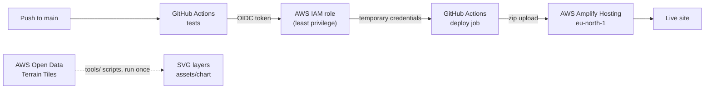

# Canary Portfolio: Joel Morera Apaza

My portfolio for the **AWS Student Builder Challenge**, drawn as a 3D sea chart of Gran Canaria, the island where I study.

**Live site:** https://main.d1zb8l9pcqy7u2.amplifyapp.com

[](https://github.com/YoelRuso/CanaryPortfolioJoel/actions/workflows/ci-cd.yml)

## What it is

- **A relief model of Gran Canaria** behind the whole page, built from real elevation data and stacked in CSS 3D layers, one every 300 m. Scrolling moves a camera from port to port: Puerto de la Luz for **About**, Agaete for **Skills** and Mogán for **Projects**, where each project is a buoy off the coast.
- **The creative feature, a pilot on board:** a scripted guide (no AI, no server) behind the "Ask the pilot" button, which flies the code flag H, "I have a pilot on board". Ask it for a project or a topic and its boat sails the course on the island while the camera follows, then the page docks at that section. You can close it with Esc, and the site works fully without it, with keyboard, mouse or touch. It respects `prefers-reduced-motion`.
- **Life on the island:** gulls circling over the ports, fish leaping now and then, dolphins beside the pilot's boat, and the Maspalomas lighthouse. A moon button in the header (or asking the pilot for "night") turns the chart to night and lights the lighthouse.
- **Optional sound**, off by default (speaker button in the header): calm waves and the ship's horn when the pilot sets sail, made in the browser with the Web Audio API, with no audio files.

## Architecture



| Service | Use |
|---|---|
| **AWS Amplify Hosting** | Hosts the site. The app has no Git connection: GitHub Actions creates the deployments. |
| **AWS IAM** | GitHub OpenID Connect provider and a deploy role. Only this repo's `production` environment can assume it, and it can only deploy the `main` branch of this one app. No AWS keys are stored anywhere. |
| **GitHub Actions** | Every push runs the tests (JavaScript syntax, HTML validation). A push to `main` that passes is zipped, uploaded to Amplify and checked until the deployment succeeds. |
| **AWS Open Data** | Terrain Tiles elevation data, downloaded once and turned into the map layers. |

Setup steps and the exact IAM policies: [docs/aws-deploy.md](docs/aws-deploy.md).

## Why no framework

Plain HTML, CSS and JavaScript on purpose: no dependencies I don't use, and proof that the browser already has what a site like this needs.

- No npm packages and no build step. Even the map scripts only use what Node.js has built in.
- About 55 KB compressed, including the 13 map layers.
- CSS 3D transforms and custom properties, `<details>`, `IntersectionObserver` and `prefers-reduced-motion` do the heavy lifting.
- Nothing to compile, nothing to keep patched, and "view source" shows the real code.

## Run it locally

Any static server works:

```bash
python -m http.server 8000
```

Then open http://localhost:8000.

## Project structure

```text
index.html            The page: three sections, the island scene and the pilot panel
css/styles.css        All styles, including the 3D scene
js/main.js            Marks the current section in the menu
js/scene.js           The island camera, labels, buoys and the pilot's boat
js/pilot.js           The pilot's script and actions
js/sound.js           Waves and the ship's horn, made with the Web Audio API
js/life.js            Leaping fish, dolphins and the night mode switch
assets/chart/         The map layers (SVG), generated by tools/
tools/                Scripts that download the elevation tiles and build the layers
docs/aws-deploy.md    AWS and GitHub setup for the deployment
.github/workflows/    CI/CD workflow
DEVLOG.md             Milestones, AWS setup, challenges and what I learned (in Spanish)
```

### Rebuilding the map

```bash
node tools/fetch-tiles.js <dir-z11> 11
node tools/fetch-tiles.js <dir-z8> 8
node tools/gen-layers.js <dir-z11> assets/chart <dir-z8>
```

## Credits

- Coastline and relief: [Terrain Tiles on the AWS Open Data registry](https://registry.opendata.aws/terrain-tiles/), see its [data sources](https://github.com/tilezen/joerd/blob/master/docs/attribution.md). Sea depths are stylised.
- Font: [Spectral](https://fonts.google.com/specimen/Spectral), from Google Fonts.
- Built by Joel Morera Apaza with the help of an AI coding agent, as the challenge allows. Who did what is recorded in [DEVLOG.md](DEVLOG.md).
